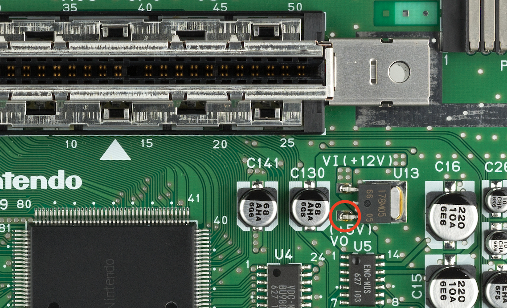
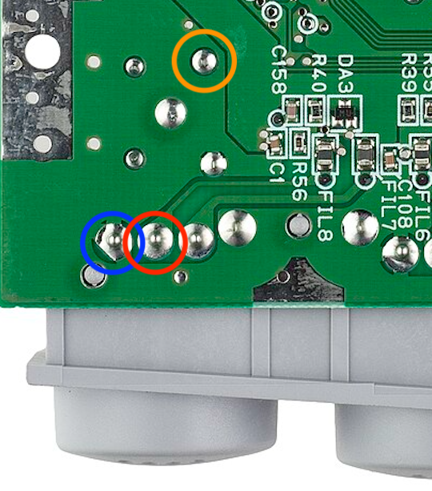

# Nintendo 64 In-Game Reset (IGR)

A standalone **in-game reset (IGR) modification for the Nintendo 64**, using an inexpensive Arduino Nano (ATmega328P).

Reset your Nintendo 64 with a controller button combination instead of reaching for the console's physical reset button.

Unlike IGR implementations built into certain RGB or HDMI modifications, this project operates independently and can be installed in an otherwise unmodified Nintendo 64.

## Features

- **Controller-based reset** — Reset the console using a configurable button combination.
- **Standalone hardware** — No RGB mod, HDMI mod, flash cartridge, or custom firmware required.
- **Passive controller monitoring** — Listens to controller port 1 without interfering with normal controller communication.
- **Configurable controls** — Customize the button combination and required hold duration.
- **Accidental reset protection** — Requires multiple valid controller polls and a sustained button combination.
- **Status LED** — The Arduino's onboard LED indicates successful controller communication decoding.
- **Minimal hardware** — Requires only an Arduino Nano, two resistors, and hookup wire.

The default reset combination is **L + R + C-Down**, held for approximately **500 milliseconds**.

## How It Works

The Nintendo 64 communicates with its controllers over a single-wire serial interface.

The Arduino Nano passively monitors controller port 1, decoding the console's controller polling commands and the controller's button responses.

When the configured button combination is held for the required duration, the Arduino briefly pulls the console's reset signal LOW, electronically simulating a press of the physical reset button.

The implementation is designed to be nonintrusive:

- The controller data connection is input-only.
- No additional pull-up is enabled on the controller data line.
- The reset output is released into a high-impedance state when inactive.
- Multiple valid controller polls are required before a reset can occur.
- The button combination must remain pressed for the configured duration.
- After resetting, the combination must be released before another reset can occur.

The sketch uses timing-sensitive AVR code to decode controller communication. Interrupts are disabled, and Timer1 provides the timing reference.

## Hardware Requirements

| Component | Quantity | Notes |
|---|---|---|
| Arduino Nano V3 | 1 | ATmega328P, 5V, 16 MHz; ELEGOO or compatible |
| 1 kΩ resistor | 1 | Controller data connection |
| 220 Ω resistor | 1 | Reset signal connection |
| Hookup wire | As needed | Thin, flexible insulated wire recommended |
| Soldering equipment | — | Fine-tip iron, solder, and flux |
| Multimeter | 1 | For verifying power and signal connections |

An optional NPN transistor circuit can be used to control the reset signal instead of connecting the Arduino GPIO directly. See [Optional Transistor Reset Circuit](#optional-transistor-reset-circuit).

## Wiring

The Arduino Nano requires four connections to the Nintendo 64 motherboard.

| Nintendo 64 Connection | Arduino Nano Pin | Notes |
|---|---|---|
| 5V power supply | `5V` | Connect to the Arduino's **5V pin, not VIN** |
| Ground | `GND` | Common ground between the N64 and Arduino |
| Controller port 1 DATA | `D2` | Through a 1 kΩ series resistor; input only |
| Reset switch signal | `D3` | Through a 220 Ω series resistor; open-drain-style output |

**Important:** The `5V` and `VIN` labels refer to pins on the **Arduino Nano**, not the Nintendo 64. The N64 provides a regulated 5V supply that connects directly to the Arduino's `5V` pin. The Arduino's `VIN` pin feeds its onboard voltage regulator and is not suitable for this connection.

### Top of Motherboard — 5V Power



- 🔴 **Red circle — 5V power:** Connect this solder point to the Arduino Nano's `5V` pin.

This connection supplies power to the Arduino directly from the Nintendo 64.

Before connecting the Arduino, verify that the indicated solder point measures approximately 5V relative to ground.

### Bottom of Motherboard — Controller Data, Reset, and Ground



- 🔴 **Red circle — Controller 1 DATA:** Connect to Arduino pin `D2` through a **1 kΩ series resistor**.
- 🟠 **Orange circle — Reset:** Connect to Arduino pin `D3` through a **220 Ω series resistor**.
- 🔵 **Blue circle — Ground:** Connect to an Arduino Nano `GND` pin.

### Controller Data Connection

The N64 controller data line operates at approximately 3.3V.

The Arduino monitors this signal using pin `D2`, configured strictly as an input without an internal pull-up.

The 1 kΩ series resistor provides some current limiting, but does not replace proper input-only configuration.

**Never configure `D2` as a 5V output or enable its internal pull-up.** Doing so could damage the console or interfere with controller communication.

### Reset Signal Connection

The Nintendo 64's physical reset button works by pulling the reset signal LOW.

The Arduino reproduces this behavior using pin `D3`, which operates in an open-drain-style configuration:

- **LOW:** Assert reset.
- **High impedance:** Release reset.

The Arduino never actively drives the reset signal HIGH in the default configuration.

Before connecting the Arduino, verify the reset signal using a multimeter:

1. With the console powered on, measure the reset signal relative to ground.
2. The signal should normally measure approximately 3.3V or 5V.
3. Press the physical reset button.
4. The signal should drop to approximately 0V.

If these measurements do not match, verify the solder point before proceeding.

### Electrical Safety

- Verify all four connections before powering on the console.
- Check for solder bridges and accidental shorts.
- Ensure the Arduino and N64 share a common ground.
- Insulate the Arduino and exposed solder joints to prevent contact with the console's shielding.
- **Disconnect the Arduino's 5V connection to the N64 before connecting USB for programming.** USB power can backfeed the console's power rail.

## Programming the Arduino

The project uses a standard Arduino sketch and can be programmed with the Arduino IDE.

1. Install the [Arduino IDE](https://www.arduino.cc/en/software).
2. Download or clone this repository.
3. Open `n64_igr.ino` in the Arduino IDE.
4. Connect the Arduino Nano to your computer using USB, with its 5V connection to the N64 disconnected.
5. Select the correct board, processor, and serial port.
6. Upload the sketch.

Recommended Arduino IDE settings:

| Setting | Value |
|---|---|
| Board | Arduino Nano |
| Processor | ATmega328P |
| Port | Your Arduino's serial port |

Some inexpensive Nano clones require the **ATmega328P (Old Bootloader)** processor option.

Clones using the CH340 USB-to-serial chip may also require an additional driver.

Once programming is complete, disconnect USB before reconnecting the Arduino to the console's 5V supply.

## Configuration

The sketch includes several configurable options near the beginning of `n64_igr.ino`.

### Reset Button Combination

The default combination is **L + R + C-Down**.

```cpp
#define RESET_COMBO (BTN_L | BTN_R | BTN_CDOWN)
```

You can change this to any supported combination using the `BTN_*` definitions in the sketch.

For example, to use L + R + Z:

```cpp
#define RESET_COMBO (BTN_L | BTN_R | BTN_Z)
```

**Note:** Avoid L + R + Start. The N64 controller uses this combination for analog stick recentering, which affects the reported button state.

### Hold Duration

The default hold duration is 500 milliseconds:

```cpp
#define HOLD_MS 500
```

Increase this value to require a longer hold and reduce the possibility of accidental resets.

In addition to the hold duration, the sketch requires at least five consecutive matching controller polls before triggering a reset.

### Reset Pulse Duration

The reset signal is held LOW for 100 milliseconds by default:

```cpp
#define RESET_PULSE_MS 100
```

This simulates a brief press of the console's physical reset button.

### Optional Transistor Reset Circuit

The default configuration connects Arduino pin `D3` to the N64 reset signal through a 220 Ω resistor.

An optional NPN transistor can be used instead, providing additional separation between the Arduino GPIO and the reset signal.

Suggested wiring:

| Connection | Destination |
|---|---|
| Arduino `D3` | NPN base through a 2.2 kΩ resistor |
| NPN emitter | Ground |
| NPN collector | N64 reset signal |
| NPN base | Ground through a 47 kΩ resistor |

Enable transistor mode in the sketch:

```cpp
#define RESET_VIA_NPN 1
```

In this configuration, the Arduino drives the transistor rather than directly pulling the reset signal LOW.

## Testing

After programming and installing the Arduino:

1. Verify all wiring and solder joints.
2. Disconnect the Arduino's USB cable.
3. Power on the Nintendo 64.
4. Start a game with a controller connected to port 1.
5. Observe the Arduino Nano's onboard LED.
6. Hold **L + R + C-Down** for approximately half a second.

The Nintendo 64 should reset as though its physical reset button had been pressed.

### Status LED

The Arduino Nano's onboard `D13` LED provides a diagnostic indicator.

During normal operation, the LED toggles approximately every 30 successfully decoded controller polls.

In a game polling at roughly 60 Hz, this produces a visible LED state change about twice per second, completing one blink cycle approximately every second.

If the LED does not blink during gameplay, the Arduino may not be successfully decoding controller communication.

## Troubleshooting

### The Arduino does not power on

- Verify the 5V and GND connections.
- Confirm that the selected power point supplies approximately 5V.
- Make sure the N64's 5V supply connects to the Arduino's `5V` pin, not `VIN`.
- Check for poor solder joints or broken wires.

### The status LED does not blink

- Confirm that a game is actively polling controller port 1.
- Verify the DATA connection to Arduino pin `D2`.
- Check the 1 kΩ series resistor.
- Confirm that the Arduino and N64 share a common ground.
- Verify that the sketch was uploaded to a compatible ATmega328P Nano.

### The LED blinks, but the console does not reset

- Verify the reset signal connection to Arduino pin `D3`.
- Confirm that the reset signal drops to 0V when the physical reset button is pressed.
- Check the 220 Ω series resistor and solder connections.
- Verify the configured button combination and hold duration.
- Confirm that `RESET_VIA_NPN` matches the installed wiring.

### The console resets unexpectedly

- Increase `HOLD_MS`.
- Choose a less common button combination.
- Inspect the reset wiring for shorts or intermittent connections.

### The controller behaves unexpectedly

- Verify that Arduino pin `D2` is configured as an input without a pull-up.
- Check for shorts between DATA and the 5V supply.
- Inspect the controller data solder joint.
- Temporarily disconnect the Arduino's DATA connection to determine whether the modification is affecting controller communication.

## Compatibility and Limitations

This project targets the **5V, 16 MHz ATmega328P Arduino Nano** and the Nintendo 64's standard controller interface.

A few considerations:

- Only controller port 1 is monitored.
- Controller polling must be active for the button combination to be detected.
- The reset operation simulates the physical reset button; it does not return to a flash cartridge menu or perform a software reset.
- Compatibility with every controller, adapter, flash cartridge, and N64 motherboard revision has not been established.
- The sketch uses timing-sensitive AVR code and is not directly portable to arbitrary Arduino-compatible microcontrollers.
- Standard Arduino timing functions such as `millis()`, `delay()`, and `Serial` are not available during normal sketch operation because interrupts are disabled.

## Project Status

This is a DIY hardware modification project intended for experimentation and personal use.

Installation requires soldering directly to the Nintendo 64 motherboard. Incorrect wiring can damage the console or connected hardware.

Verify all voltages and connections before powering on the modified console.

## License

This project is licensed under the [MIT License](LICENSE).

You're free to use, modify, distribute, and build upon this project, including for commercial purposes, provided the original copyright and license notices are retained. 

This project is provided as-is, without warranty. Hardware modifications are performed at your own risk.
